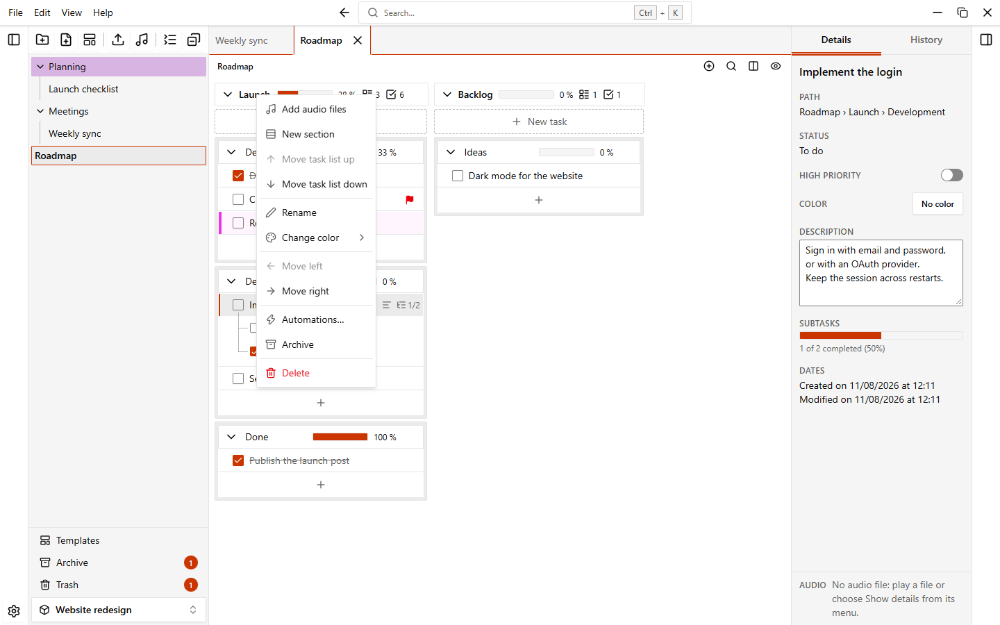

# Audio files

You can attach audio files to a group and play them while you work, without leaving the note. EasyTask stores the path of each file, not a copy.

## Add audio files

1. Open the menu of a group.
2. Choose **Add audio files**.
3. Pick one or more files. Supported formats: `mp3`, `wav`, `ogg`, `m4a`, `aac`, `flac`, `opus` and `webm`.

The files appear as a list in the group. Click a file to play it. The icon of the file shows its state: playing, paused, ended or not loaded.

::: warning The file stays where it is
EasyTask keeps the path of the file. If you move, rename or delete the file on your computer, EasyTask can no longer find it. See [Missing files](#missing-files).
:::

Each file has a menu with **Rename**, **Show details**, **Update path** and **Delete**. **Delete** moves the reference to the [trash](./trash-and-archive); the file on your computer is not touched.

## The floating player

When you play a file, a small player opens over the note. Drag its top bar to move it. It remembers where you left it. The pin button on the left of the top bar locks the player in place until you unpin it.

| Control | What it does |
| --- | --- |
| Play / Pause | Starts or pauses the track |
| Restart from the beginning | Plays the track again from 0:00 |
| Back 15 seconds / Forward 15 seconds | Jumps in the track |
| Seek bar | Click or drag to move to a point. With the bar focused, the arrow keys move by 5 seconds and `Space` plays or pauses |
| Speed | Click to cycle through 0.75×, 1×, 1.25×, 1.5× and 2×. |
| Mute and volume | Mutes the sound, or sets the volume. Muting is not saved |
| X (Close the player) | Pauses the track and closes the player |

Click the file that is playing to pause it, and again to resume.

### Keyboard and media keys

- `Alt+P` plays or pauses the audio while the player is open. You can change it in **Settings > Shortcuts**.
- The media keys of your keyboard, and the media controls of the system (the volume flyout and the lock screen), show the title of the track and can play, pause and skip.

## Images and videos

A group can also hold images and videos. Like audio files they are linked, not copied: EasyTask stores only the path.

1. Open the menu of the group.
2. Choose **Add image or video**.
3. Pick one or more files. Supported formats: `jpg`, `jpeg`, `png`, `gif`, `webp`, `avif`, `bmp` for images and `mp4`, `webm`, `mov`, `m4v` for videos. Whether a video plays depends on the codecs of your system.

They are listed one under the other, right under the audio files, each with a small thumbnail. Click a file to open the viewer, a full-window view:

- an image zooms with the mouse wheel, moves when you drag it while zoomed, and goes back to its size with a double click
- a video has the usual playback controls
- the left and right arrow keys, or the buttons at the sides, show the previous and next file of the group
- `Esc` closes the viewer

Each file has a menu with **Rename**, **Update path** and **Delete**, which works like it does for audio files. The number of images and videos is shown in the header of the group next to the number of audio files, and both follow the setting **Show number of audio files, images and videos**.

## Missing files

When a group is shown, EasyTask checks that its audio files, images and videos are still at their saved path. A file that is not found has a warning icon (and a grey thumbnail for images and videos), and **Update path** is highlighted in its menu.

When you click a file that is no longer at its saved path, EasyTask shows **File not found** with the path it expected. You can:

- click **Update path** and pick the file in its new place
- click **Delete reference** to remove it from the group

You can also choose **Update path** from the menu of a file at any time, for example when you move your music folder.

## Audio settings

Open **Settings > Audio** to change how the player looks and behaves. The options are in the [Settings](./settings#audio) page. If the floating player is turned off, files do not play and EasyTask shows a message that tells you to enable it.

Audio paths are included when you export a workspace. Images and videos are not exported yet. When you import it on another computer, files that are not found there are skipped. See [Data and backups](./data-and-backups).
