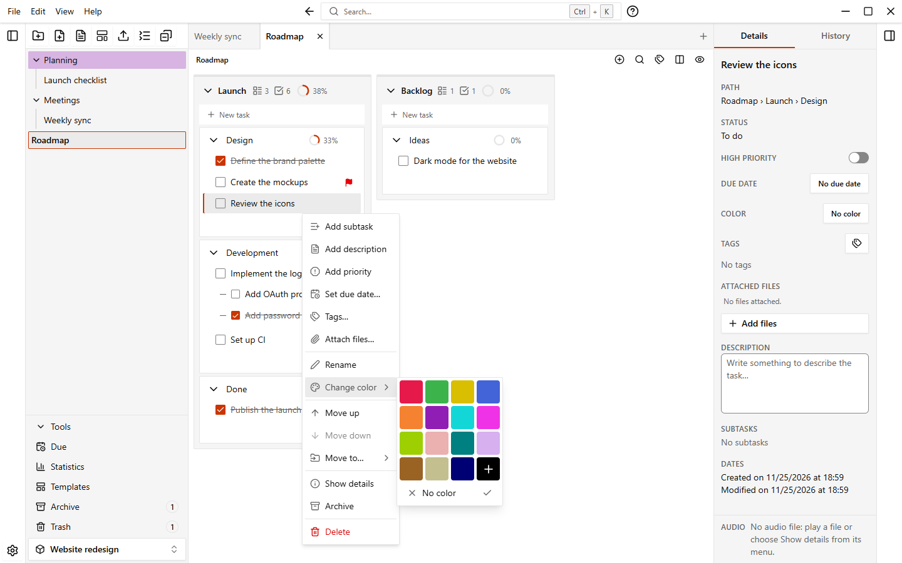
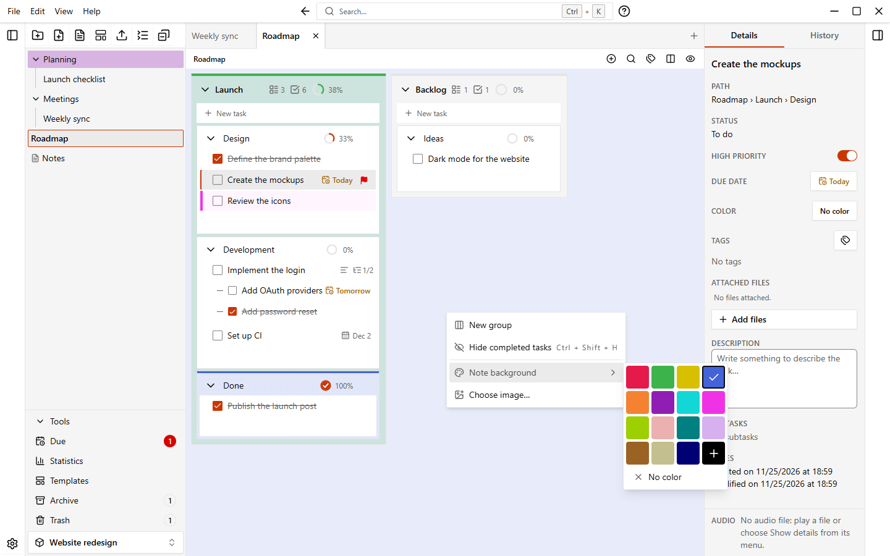

# Colors

You can give a color to workspaces, folders, notes, groups, sections and tasks. Colors help you find things at a glance.

## Give a color to an item

1. Open the menu of the item (the **...** button or a right click).
2. Choose **Change color**.
3. Click a color of the palette.

The menu of every item has this entry: workspaces on the home page, folders and notes in the sidebar, groups, sections and tasks in the note. The details panel also shows the color of the selected item in a **Color** field: click it to open the same palette.

## The palette

The palette has 15 colors:

| | | | |
| --- | --- | --- | --- |
| Red | Green | Yellow | Blue |
| Orange | Purple | Cyan | Magenta |
| Lime | Pink | Teal | Lavender |
| Brown | Cream | Navy | |

The last square of the palette, with a **+**, lets you pick **any other color** with the color picker of your system. The color is applied when you close the picker. A custom color is shown in that square when it is selected.

## Remove a color

Open the same palette and click **No color**.

## Automatic color of a group

The color menu of a group (not of the other items) starts with **Automatic**. The group takes its color from its progress, and changes it by itself as you complete tasks:

- **red** when none of its tasks is completed;
- **yellow** when at least one is completed, but not all;
- **green** when all are completed, or when the group has no tasks.

Tasks and subtasks count as in the progress ring of the group. While it is on, no swatch of the palette is marked; choose a fixed color or **No color** to turn it off. The automatic color is kept by duplicates, templates, undo and redo, and exports.

The same menu has **Due dates**: the group takes the color of the nearest [due date](./due-dates) among its open tasks and subtasks: red when one is overdue, yellow when the nearest is today or tomorrow, green when it is later. A group with no due dates has no color.

::: warning Older versions of EasyTask
Versions before 0.26.0 do not know the automatic color. If you import a workspace with an automatic group in one of them, the group is shown without that color. Choose a fixed color before exporting if you need the workspace in an older version.
:::

## Note background

You can give a color to the whole background of a note.

1. Right-click the empty space of an open note (outside groups, sections and tasks).
2. Choose **Note background**.
3. Click a color of the palette.

The color is a light layer that stays readable in both the light and the dark theme, and it follows **Color intensity**. Choose **No color** to remove it. You can undo it with `Ctrl+Z`. The background is kept when you duplicate a note, in templates and in exports.

You can also use a picture as the background of a note. In the same menu choose **Choose image…** and pick an image file (JPG, PNG, GIF, WebP, AVIF or BMP); it fills the note area and the color, if you set one, stays on top of it as a light layer, so the text stays readable in both themes. Choose **Remove image** to take it away. The picture is saved per note as a link to the file (it is not copied), so if you move or delete the file the note simply shows no picture. It is kept when you duplicate a note, in templates and in exports; in a `.easytask.zip` export the image file travels with the archive like images and videos.

## Color the content of a folder

The folder menu has **Color content**. It gives the color of the folder to all its subfolders and to all the notes inside them. Use it when you changed the color of a folder and want everything in it to match.

You can undo it, see [Undo and history](./undo-and-history).

## Color several items at once

Select folders and notes in the sidebar (`Ctrl+click` adds an item, `Shift+click` selects a range), open the menu of one of them and choose **Color**. The palette applies to the whole selection.

## Colors when you create something

The dialogs for a new workspace, folder and note have a palette button next to the name. Click it to choose a color before you create the item. A note created from a template starts with the color of the template, see [Templates](./templates).

## Colors in Settings

Open **Settings > Appearance**.

- **Accent color**: used for buttons, selections and highlights. Every [theme](./themes) has its own accent; the color you pick here overrides it, and **Use the accent of the theme** brings the theme's one back.
- **Color intensity**: how strongly the colors of folders, notes, groups, sections and the note background show. It goes from 25% to 175% (100% is the default) and has a **Reset** button. It also changes the light background of colored tasks, not their color bar.

### Contrast warning

If the accent color has too little contrast with the background of the current theme, a warning appears under the setting. Borders, selections and highlights may be hard to see with that color. The warning offers the closest color with enough contrast: click the **Use #XXXXXX** button (it shows the suggested color and its contrast ratio) to apply it. The check follows the theme you are using, so a color can be fine in the light theme and get a warning in the dark one.

## Colors set by automations

An [automation](./automations) can color a task, a group or a section by itself, for example a section that turns green when all its tasks are completed. You can also change that color by hand.

::: tip
The color intensity setting is useful when a very strong color hurts readability, or when pale colors are hard to see.
:::
