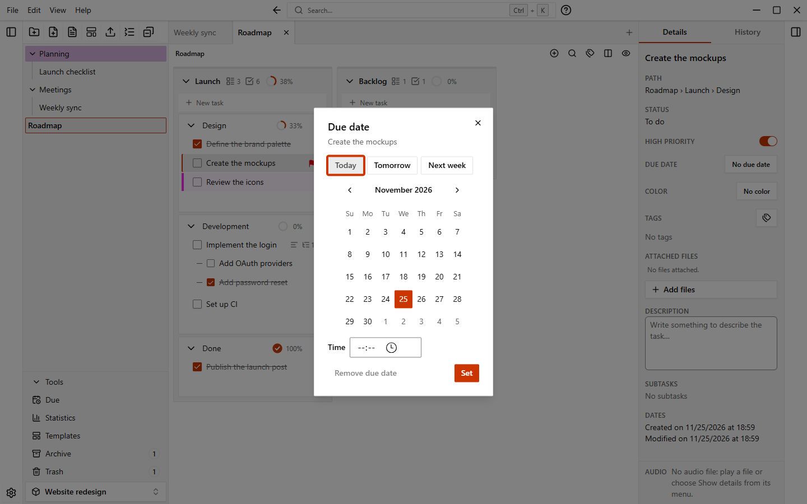
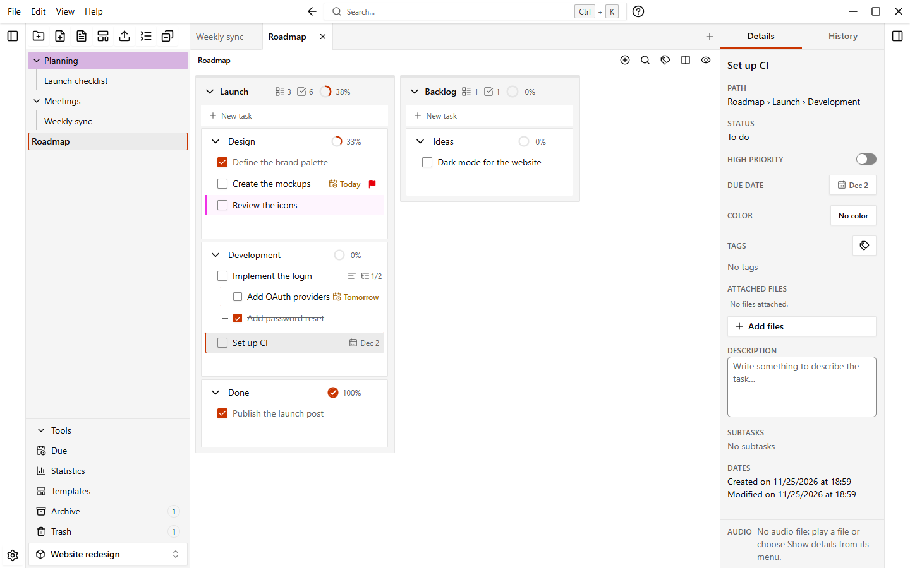
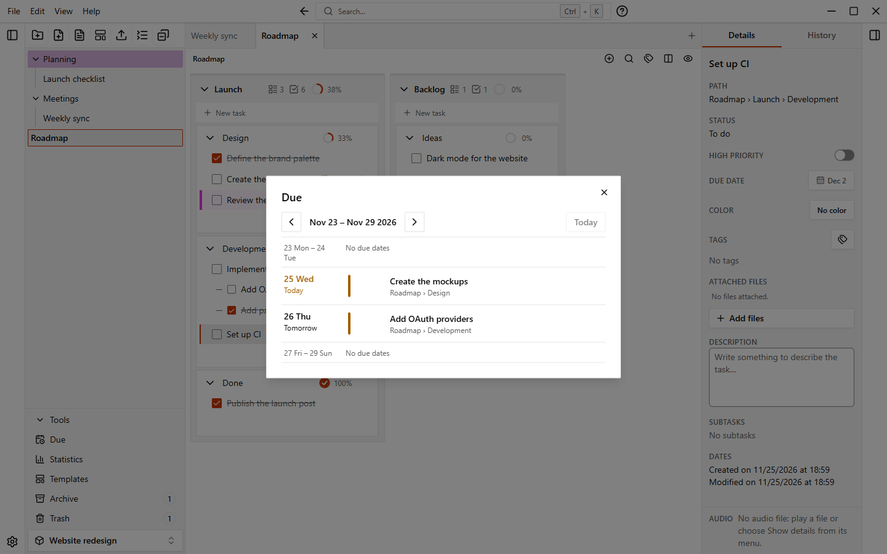

# Due dates

A task can have a due date, with an optional time. EasyTask shows it on the task, collects the tasks in an agenda, and can notify you when they are due.

## Set a due date

- Open the menu of the task and choose **Set due date…**. The entry reads **Change due date…** when the task already has one, and **Remove due date** takes it away.
- Or use the **Due date** field in the [details panel](./groups-sections-tasks#the-details-panel).

The window has a calendar, the shortcuts **Today**, **Tomorrow** and **Next week**, and a **Time** field. The time is optional: **No time** removes it. Click **Set** to save. Setting or removing a due date can be undone with `Ctrl+Z`.

## The badge on the task

A task with a due date shows a small badge under its text with the date ("Today, 14:30", "Tomorrow", "Yesterday", or the day). The color and the icon tell where the task stands:

| Look | Meaning |
| --- | --- |
| Grey | Due later |
| Yellow | Due today or tomorrow |
| Red | Overdue |

Each state has its own icon, so the color is never the only signal, and a screen reader reads "Due" or "Overdue". A completed task is never overdue: its badge stays neutral.

## The Due agenda

Open **Due** from the **Tools** section of the sidebar (see [The sidebar](./folders-and-notes#the-sidebar)). The window shows the open tasks of the workspace as an agenda, one week at a time, from Monday to Sunday:

- each day lists its tasks with their time, their text and the note and section they belong to;
- days with no tasks are folded into one line;
- on the current week, the tasks that are overdue from before are in an **Overdue** block on top;
- use the arrows (or the `←` and `→` keys) to change week, and **Today** (or `Home`) to come back to the current week.

Click a task, or press `Enter` on it: EasyTask opens its note, selects the task and scrolls to it, in another workspace too. Completed tasks, and tasks in the trash or the archive, are not listed.

## Notifications

EasyTask can notify you when tasks are due:

- a task with a due **time** is notified at that time;
- the other due dates that matter (overdue and due today) arrive in **one summary** when EasyTask starts, and again every morning;
- each due date is notified once. If you change the date of a task, the new date is notified again;
- it works also while EasyTask runs in the notification area. Click a notification to bring EasyTask to the front: when it was about a single task, the task is opened.

The switch is **Due date notifications** in **Settings > System**. It is on by default. The system may ask you to allow notifications from EasyTask the first time.

## Automations and colors

- The [automation](./automations) trigger **a task becomes overdue** starts once for each due date, when the task passes it. The actions apply to the task.
- The color menu of a group has **Due dates**: the group takes the color of the nearest due date of its tasks (red overdue, yellow today or tomorrow, green later). See [Colors](./colors#automatic-color-of-a-group).

## Copies, templates and export

Duplicates, copies and pastes of tasks, the trash, undo and exports keep the due dates. [Templates](./templates) do not: a date saved in a template would already be overdue when you use it, so a note created from a template starts without due dates.

A file exported by this version opens in an older version of EasyTask without the due dates.
