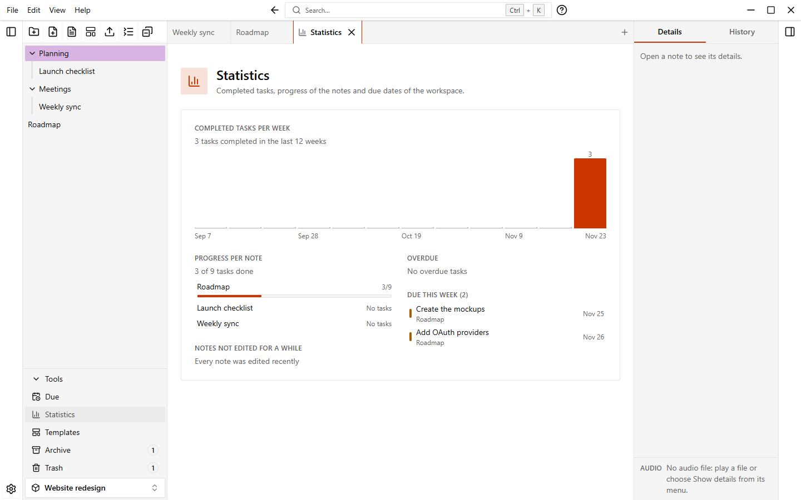

# Statistics

The Statistics tab shows how the work of the workspace is going. Open it from **Statistics** in the **Tools** section of the sidebar (see [The sidebar](./folders-and-notes#the-sidebar)), from the **View** menu, or from the command menu (`Ctrl+K`). It opens as a tab, like **What's new**: if it is already open it comes to the front, and it is not reopened at the next start.

## What it shows

| Block | What it tells you |
| --- | --- |
| **Completed tasks per week** | A bar for each of the last 12 weeks, with the number of tasks you completed. |
| **Progress per note** | For each note, how many tasks are done out of the total. |
| **Notes not edited for a while** | Notes with no change, in the note or in its tasks, for 30 days or more, and for how long. |
| **Overdue** | The open tasks past their [due date](./due-dates). |
| **Due this week** | The open tasks due in the next days. |

Each list shows the first rows: click **Show all** for the rest. Click a note to open it in a tab. Click a task to open its note on that task. Items in the trash or the archive are not counted.

## The completion date

From version 0.29.0 EasyTask records the moment a task is completed, and clears it if you reopen the task. Tasks that were already completed use the date of their last edit, so the chart is not empty: for them the week is only approximate. Duplicates of a note keep the completion dates; a template does not, and a note created from it starts with none.
