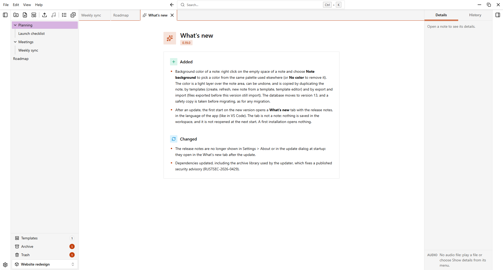
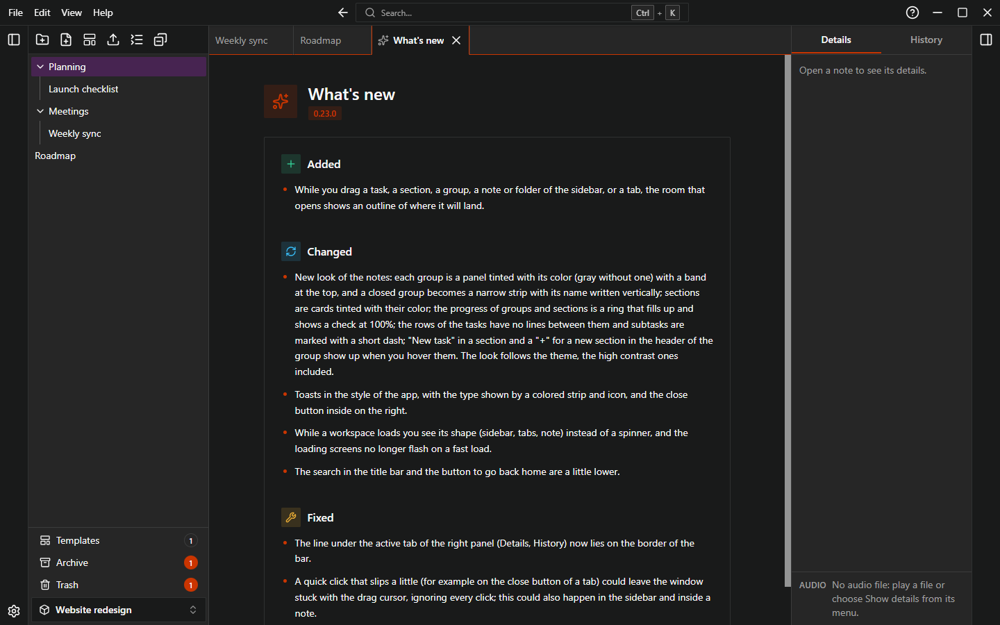

# Updates

The installed app can check for new versions, download them and install them. Updates are signed and verified before installation.

## Check at startup

A few seconds after startup, EasyTask looks silently for a new version. If one is available, an **Update available** dialog shows the new version number. It offers three choices:

| Button | What it does |
| --- | --- |
| **Update now** | Downloads and installs the update, then restarts the app. |
| **Later** | Closes the dialog. It is offered again at the next start. |
| **Skip this version** | Not offered again until a newer version is out. |

If another dialog is open, EasyTask shows a short notice with **Show** and opens the update dialog when the other one is closed.

Do not close the app while it downloads and installs: it restarts by itself.

To turn the startup check off, go to **Settings > About** and turn off **Check at startup**.

If the check fails (for example you are offline), the startup check shows nothing.

## Check manually

1. Open **Settings > About**.
2. Click **Check for updates**.
3. If a version is available, the app shows its number. Click **Update now** to download, install and restart.

If you are up to date, the app says "EasyTask is up to date."

## What's new after an update

The first time you open a workspace after an update, a **What's new** tab opens with the release notes of the version you are now using, in the language of the app.

{.light-only}
{.dark-only}

- It opens only once for each update.
- Close it like a note: **Close current note** or `Ctrl+L`.
- It is not a note: it has no menu and it is not reopened at startup.
- A new installation does not show it.

## Release notes

To read the release notes of the previous versions, choose **Help > Release notes** in the menu. It opens the Releases page in your browser.

## Portable version

The portable version does not update itself. The update check shows a notice and an **Open the Releases page** button. To update, download the new zip and replace `EasyTask.exe`: your `data` folder is kept. See [Install](./install).
