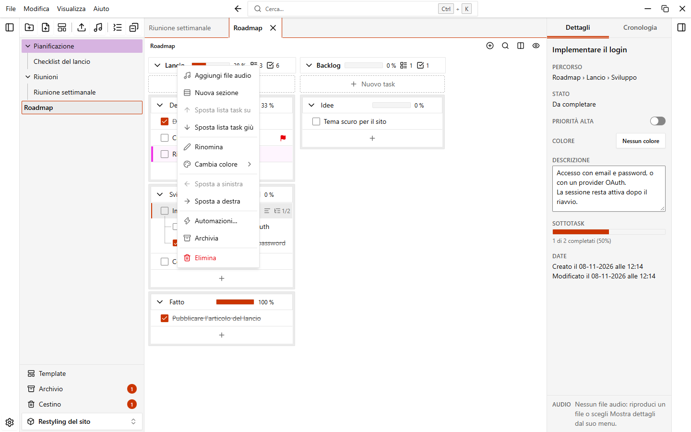

# File audio

Puoi allegare file audio a un gruppo e ascoltarli mentre lavori, senza uscire dalla nota. EasyTask salva il percorso di ogni file, non una copia.

## Aggiungere file audio

1. Apri il menu di un gruppo.
2. Scegli **Aggiungi file audio**.
3. Seleziona uno o più file. Formati supportati: `mp3`, `wav`, `ogg`, `m4a`, `aac`, `flac`, `opus` e `webm`.

I file compaiono come elenco nel gruppo. Clicca un file per riprodurlo. L'icona del file ne mostra lo stato: in riproduzione, in pausa, terminato o non caricato.

::: warning Il file resta dov'è
EasyTask conserva il percorso del file. Se sposti, rinomini o elimini il file sul computer, EasyTask non lo trova più. Vedi [File mancanti](#file-mancanti).
:::

Ogni file ha un menu con **Rinomina**, **Mostra dettagli**, **Aggiorna percorso** ed **Elimina**. **Elimina** sposta il riferimento nel [cestino](./trash-and-archive); il file sul computer non viene toccato.

## Il player flottante

Quando riproduci un file, sopra la nota si apre un piccolo player. Trascina la barra in alto per spostarlo. Ricorda dove l'hai lasciato. Il pulsante con la puntina a sinistra della barra blocca il player dov'è finché non lo sblocchi.

| Comando | Cosa fa |
| --- | --- |
| Riproduci / Pausa | Avvia o mette in pausa la traccia |
| Riparti dall'inizio | Riproduce la traccia da 0:00 |
| Indietro di 15 secondi / Avanti di 15 secondi | Salta nella traccia |
| Barra di posizione | Clicca o trascina per andare a un punto. Con la barra selezionata, le frecce spostano di 5 secondi e `Spazio` avvia o mette in pausa |
| Velocità | Clicca per passare tra 0.75×, 1×, 1.25×, 1.5× e 2×. |
| Silenzia e volume | Silenzia l'audio o imposta il volume. Il silenzio non viene salvato |
| X (Chiudi il player) | Mette in pausa la traccia e chiude il player |

Clicca il file in riproduzione per metterlo in pausa, e di nuovo per riprendere.

### Tastiera e tasti multimediali

- `Alt+P` avvia o mette in pausa l'audio mentre il player è aperto. Puoi cambiarla in **Impostazioni > Scorciatoie**.
- I tasti multimediali della tastiera e i controlli multimediali del sistema (il pannello del volume e la schermata di blocco) mostrano il titolo della traccia e permettono di riprodurre, mettere in pausa e saltare.

## Immagini e video

Un gruppo può contenere anche immagini e video. Come i file audio sono collegati, non copiati: EasyTask salva solo il percorso.

1. Apri il menu del gruppo.
2. Scegli **Aggiungi immagine o video**.
3. Seleziona uno o più file. Formati supportati: `jpg`, `jpeg`, `png`, `gif`, `webp`, `avif`, `bmp` per le immagini e `mp4`, `webm`, `mov`, `m4v` per i video. La riproduzione di un video dipende dai codec del tuo sistema.

Sono elencati uno sotto l'altro, subito sotto i file audio, ciascuno con una piccola anteprima. Clicca un file per aprire il visualizzatore, una vista a tutta finestra:

- un'immagine si ingrandisce con la rotella del mouse, si sposta trascinandola quando è ingrandita e torna alla dimensione originale con un doppio clic
- un video ha i comandi di riproduzione consueti
- le frecce sinistra e destra, o i pulsanti ai lati, mostrano il file precedente e quello successivo del gruppo
- `Esc` chiude il visualizzatore

Ogni file ha un menu con **Rinomina**, **Aggiorna percorso** ed **Elimina**, che funziona come per i file audio. Il numero di immagini e video compare nell'intestazione del gruppo accanto al numero di file audio, ed entrambi seguono l'impostazione **Mostra il numero di file audio, immagini e video**.

## File mancanti

Quando un gruppo viene mostrato, EasyTask controlla che i suoi file audio, le immagini e i video siano ancora nel percorso salvato. Un file che non si trova ha un'icona di avviso (e un'anteprima grigia per immagini e video), e **Aggiorna percorso** è evidenziato nel suo menu.

Quando clicchi un file che non si trova più nel percorso salvato, EasyTask mostra **File non trovato** con il percorso che si aspettava. Puoi:

- cliccare **Aggiorna percorso** e scegliere il file nella nuova posizione
- cliccare **Elimina riferimento** per toglierlo dal gruppo

Puoi scegliere **Aggiorna percorso** anche dal menu di un file in qualsiasi momento, per esempio quando sposti la cartella della musica.

## Impostazioni audio

Apri **Impostazioni > Audio** per cambiare aspetto e comportamento del player. Le opzioni sono nella pagina [Impostazioni](./settings#audio). Se il player flottante è disattivato, i file non vengono riprodotti ed EasyTask mostra un messaggio che ti dice di abilitarlo.

Quando esporti un workspace, una nota o una cartella, EasyTask chiede se includere i file collegati (audio, immagini e video): con i file ottieni un `.easytask.zip`, senza un `.easytask.json` con i soli percorsi. Quando importi un `.easytask.json` su un altro computer, i file che non vengono trovati sono saltati. Vedi [Dati e backup](./data-and-backups).
