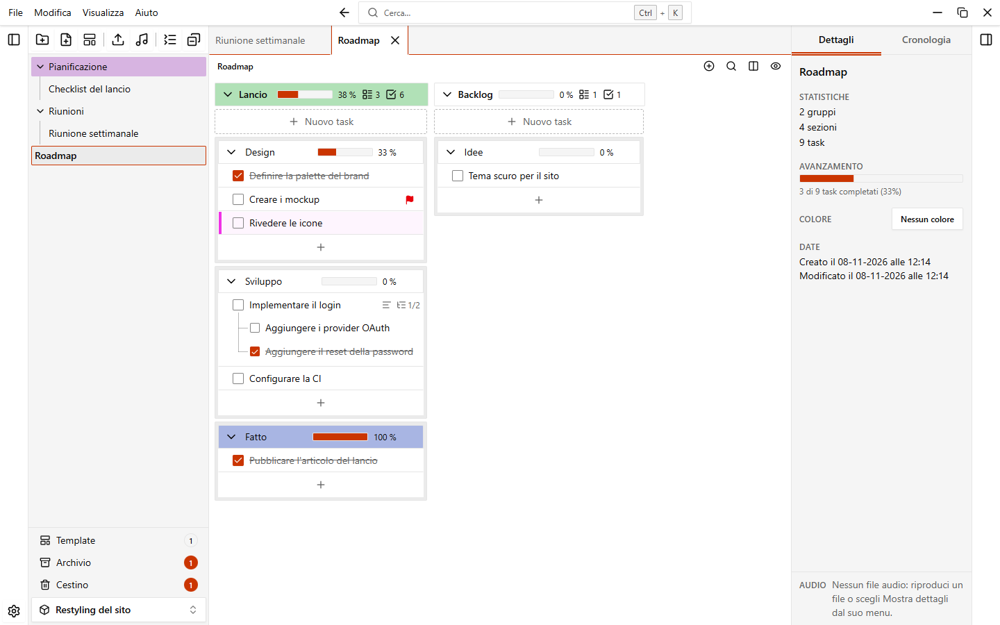
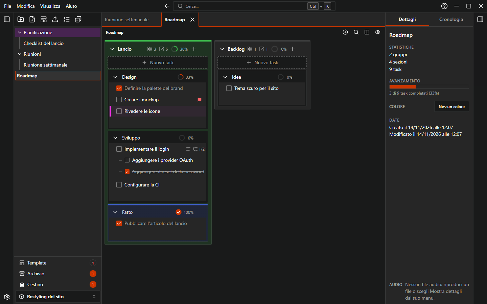
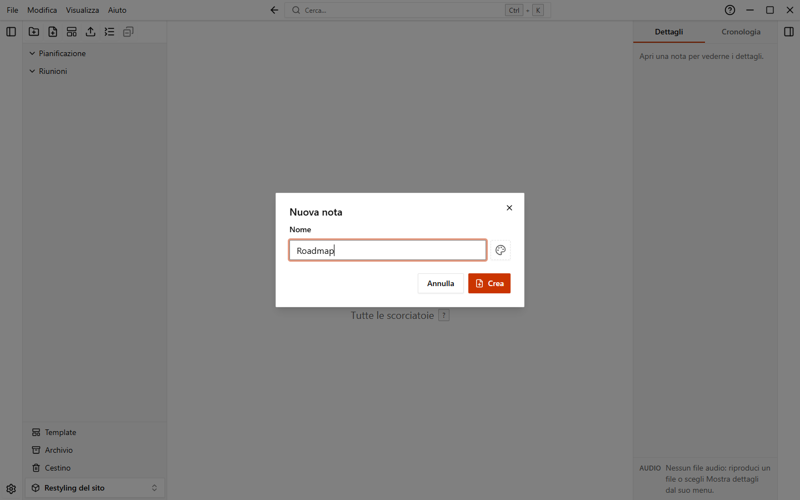
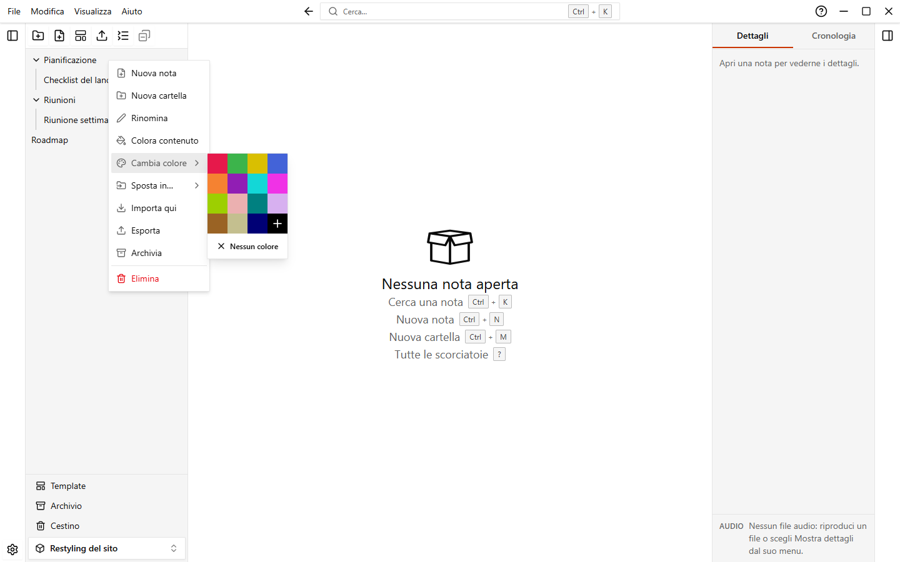
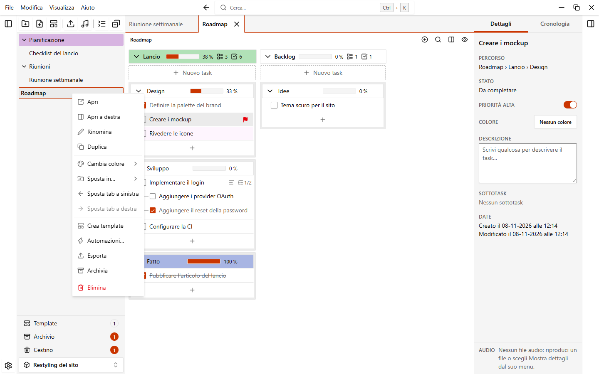
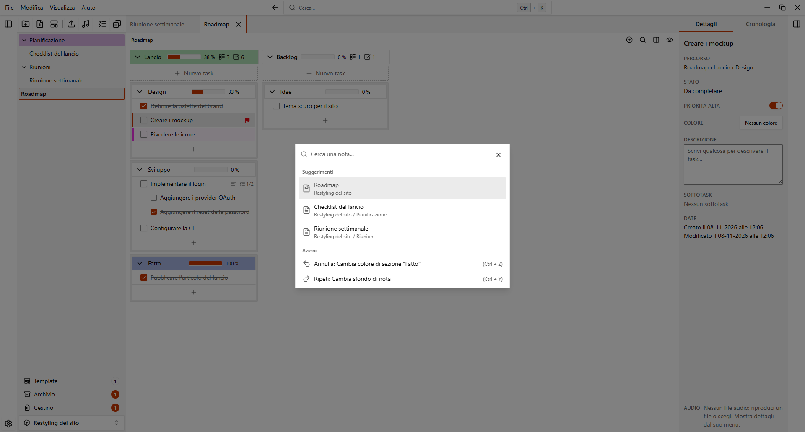

# Cartelle e note

Dentro un workspace, la barra laterale sinistra mostra un albero di cartelle e note. Le cartelle possono contenere altre cartelle, senza limiti di profondità. Le note contengono i tuoi task e si aprono in tab.

{.light-only}
{.dark-only}

## La barra laterale

In cima alla barra laterale c'è una fila di pulsanti:

| Pulsante                                  | Cosa fa                                                         |
| ----------------------------------------- | --------------------------------------------------------------- |
| **Nuova cartella**, **Nuova nota**, **Nuova nota da template** | Creano elementi. Vedi sotto.               |
| **Importa una nota o una cartella**       | Importa un file `.easytask.json` o `.easytask.zip` di una nota o cartella. |
| **Comprimi tutte le cartelle** / **Espandi tutte le cartelle** | Chiude o apre tutte le cartelle in un colpo. |
| **Chiudi tutte le note**                  | Chiude tutti i tab aperti.                                  |

In basso trovi **Template**, **Archivio**, **Cestino** (con un contatore di quanto contengono) e il selettore del workspace, per passare a un altro workspace. Vedi [Template](./templates) e [Cestino e archivio](./trash-and-archive).

Fai clic destro su un'area vuota dell'albero per creare una nota, una cartella o una nota da template, per importare e per comprimere o espandere tutte le cartelle.

### Mostrare, nascondere e ridimensionare

- `Ctrl+B` mostra o nasconde la barra laterale. Puoi usare anche **Visualizza > Barra laterale** nel menu dell'applicazione.
- Trascina il bordo della barra laterale per ridimensionarla. Con il bordo selezionato, le frecce `Sinistra` e `Destra` cambiano la larghezza e `Maiusc` rende il passo più grande.
- In una finestra stretta (sotto i 900 pixel) la barra laterale diventa un pannello sovrapposto: parte chiusa e copre la nota finché è aperta.

Per rendere le righe più piccole o più grandi vai in **Impostazioni > Aspetto > Dimensione di cartelle e note** e scegli **Compatta**, **Normale** o **Grande**.

## Creare cartelle e note

| Azione                              | Come                                                                                         |
| ----------------------------------- | -------------------------------------------------------------------------------------------- |
| Nuova nota nella radice del workspace | Pulsante **Nuova nota**, `Ctrl+N`, oppure **File > Nuova nota**                            |
| Nuova cartella nella radice         | Pulsante **Nuova cartella**, `Ctrl+M`, oppure **File > Nuova cartella**                      |
| Nuova nota o cartella dentro una cartella | Apri il menu della cartella e scegli **Nuova nota** o **Nuova cartella**               |
| Nuova nota da un template           | Pulsante **Nuova nota da template**, oppure **File > Nuova nota da template…**               |

Nella finestra **Nuova nota** scrivi un **Nome**. Puoi anche scegliere un template in **Da template** (di default **Nessun template**). Nella radice del workspace puoi dare subito un colore alla nota.

I nomi devono essere unici nella stessa cartella. Se un nome è già usato, la finestra mostra un errore.

## Rinominare, colorare e spostare

Fai clic sul pulsante del menu di una riga (compare quando ci passi sopra) oppure fai clic destro sulla riga.

| Voce                 | Cartella | Nota | Cosa fa                                                                        |
| -------------------- | :------: | :--: | ------------------------------------------------------------------------------ |
| **Nuova nota**, **Nuova cartella** | sì |  | Crea l'elemento dentro la cartella.                                          |
| **Apri**             |          | sì   | Apre la nota in un tab.                                                    |
| **Apri a destra**    |          | sì   | Apre la nota nell'area destra, creando la divisione se serve. Vedi [Dividere in due aree](#dividere-in-due-aree). |
| **Apri a sinistra**  |          | sì   | Sposta una nota dell'area destra in quella sinistra (solo se la nota è aperta a destra). |
| **Rinomina**         | sì       | sì   | Il nome diventa un campo di testo sul posto. `Invio` salva, `Esc` annulla.     |
| **Duplica**          |          | sì   | Crea una copia chiamata per esempio `Roadmap (copia)` e la apre.               |
| **Colora contenuto** | sì       |      | Dà il colore della cartella a tutte le note e sottocartelle al suo interno.    |
| **Cambia colore**    | sì       | sì   | Imposta o toglie il colore dell'elemento.                                      |
| **Sposta in…**       | sì       | sì   | Sposta l'elemento in un'altra cartella o nella **Radice del workspace**.       |
| **Sposta tab a sinistra**, **Sposta tab a destra** | | sì | Riordina il tab (solo se la nota è aperta).                      |
| **Crea template**    |          | sì   | Salva la nota come template. Vedi [Template](./templates).                     |
| **Automazioni…**     |          | sì   | Apre le automazioni della nota. Vedi [Automazioni](./automations).             |
| **Importa qui**      | sì       |      | Importa dentro la cartella un file di una nota o di una cartella.              |
| **Esporta**          | sì       | sì   | Salva l'elemento in un file `.easytask.json` (o `.easytask.zip` con i file collegati). |
| **Archivia**         | sì       | sì   | Nasconde l'elemento senza eliminarlo.                                          |
| **Elimina**          | sì       | sì   | Sposta l'elemento nel cestino, dopo conferma.                                  |

Puoi anche dare un colore allo sfondo di una nota aperta, vedi [Sfondo della nota](./colors#sfondo-della-nota).

### Spostare con il trascinamento

Trascina una riga dell'albero e rilasciala dove vuoi:

- Su una nota: l'elemento va prima (metà alta) o dopo (metà bassa).
- Su una cartella: al centro della riga l'elemento va dentro la cartella; vicino al bordo alto o basso, prima o dopo.

Mentre trascini, le altre righe si scostano per aprire lo spazio dove l'elemento atterrerebbe e lo spazio che lascia si richiude, così vedi l'ordine finale prima di rilasciare. Una cartella aperta si muove con le righe al suo interno. Sul centro di una cartella le righe restano ferme e la cartella è evidenziata. Con **Task, sezioni, gruppi, note, cartelle e tab che si spostano mentre li trascini** spento in **Impostazioni > Note e sezioni** si vede invece una linea che mostra dove cade, come quando trascini più elementi selezionati o usi la tastiera.

Puoi trascinare anche con la tastiera: seleziona una riga, premi `Spazio`, spostati con le frecce, premi di nuovo `Spazio` per rilasciare, `Esc` per annullare. **Sposta in…** nel menu è un altro modo che non richiede il trascinamento.

::: info
Una cartella non si può spostare dentro se stessa o in una sua sottocartella.
:::

### Selezionare più elementi

1. `Ctrl`+clic su una riga la aggiunge alla selezione o la toglie.
2. `Maiusc`+clic seleziona tutte le righe tra l'ultima cliccata e questa.
3. Fai clic destro su una riga selezionata (o usa il suo pulsante del menu) per agire su tutta la selezione.

Il menu offre allora **Sposta**, **Colore**, **Esporta**, **Archivia N elementi** ed **Elimina N elementi** per tutti gli elementi selezionati, e puoi trascinare la selezione per spostarla in blocco. `Esc` annulla la selezione. Anche un semplice clic su una riga la annulla.

## Aprire le note in tab

Fai clic su una nota nella barra laterale per aprirla. Le note aperte compaiono come tab sopra la nota. Fai clic destro su un tab per avere lo stesso menu della nota.

| Azione                     | Come                                                              |
| -------------------------- | ----------------------------------------------------------------- |
| Nota successiva            | `Ctrl+PageDown` o `Ctrl+Tab`                                        |
| Nota precedente            | `Ctrl+PageUp` o `Ctrl+Maiusc+Tab`                                  |
| Chiudere la nota attiva    | `Ctrl+L`, o il pulsante **Chiudi nota corrente** sul tab        |
| Chiudere tutte le note     | `Ctrl+T`, o il pulsante **Chiudi tutte le note** nella barra laterale |
| Riordinare i tab           | Trascina un tab, oppure usa **Sposta tab a sinistra** / **Sposta tab a destra** |
| Dividere in due aree       | `Ctrl+\` (`Cmd+\` su macOS), o il pulsante **Dividi in due aree**    |

Puoi cambiare ogni scorciatoia modificabile in **Impostazioni > Scorciatoie**. Vedi [Scorciatoie da tastiera](./shortcuts).

### Dividere in due aree

Puoi tenere due note affiancate. Ogni area ha la sua barra di tab e la sua nota aperta.

- Fai clic su **Dividi in due aree** a destra della barra del percorso, oppure premi `Ctrl+\` (`Cmd+\` su macOS). A destra compare un'area vuota. Fai clic su **Chiudi la divisione** (o premi la stessa scorciatoia) per tornare a una sola area: questo chiude i tab dell'area destra.
- Una nota è aperta in una sola area alla volta. Se apri una nota già aperta nell'altra area, EasyTask passa a quella.
- Per spostare una nota, trascina il suo tab nell'altra barra di tab (o rilasciala nella barra vuota). Mentre trascini, gli altri tab si scostano per aprire lo spazio dove atterrerebbe e lo spazio che lascia si richiude; con **Task, sezioni, gruppi, note, cartelle e tab che si spostano mentre li trascini** spento in **Impostazioni > Note e sezioni** una linea mostra invece dove cade. Lo stesso vale per riordinare i tab di una sola barra. Senza il mouse, usa **Apri a destra** / **Apri a sinistra** nel menu della nota o del suo tab, oppure premi `Ctrl+Alt+→` (anche `Ctrl+Alt+←`) per spostare la nota attiva nell'altra area. **Apri a destra** crea la divisione se non c'è.
- `Ctrl+Alt+\` sposta il focus sull'altra area.
- L'area su cui hai fatto clic per ultima è quella con il focus. La barra laterale, il menu comandi, il pannello dettagli e le scorciatoie (chiudi la nota, nota successiva o precedente, cerca nella nota, nuovo gruppo, annulla e ripeti) agiscono su di essa.
- Trascina il divisore tra le aree per ridimensionarle. Con il divisore selezionato, le frecce cambiano la dimensione (`Maiusc` per passi più grandi) e il doppio clic la riporta al 50%. Ogni area è larga almeno 320 pixel e le barre laterali si chiudono da sole quando manca lo spazio.

La divisione e i tab di ogni workspace vengono riaperte al prossimo avvio se **Riapri le note all'avvio** è attivo. Le aree possono essere al massimo due.

Le tre scorciatoie della divisione si possono cambiare in **Impostazioni > Scorciatoie**, tranne `Ctrl+Alt+←`.

### La barra del percorso

Sotto i tab, una barra sottile mostra il percorso della nota aperta, ad esempio `Lavoro > Progetti > Piano`. Fai clic su una cartella o sulla nota nel percorso per mostrarla nella barra laterale: la barra si apre se era chiusa, le cartelle sopra si espandono e l'elemento viene selezionato. Un percorso lungo mantiene la prima cartella e gli ultimi due elementi. A destra della stessa barra ci sono quattro pulsanti: **Nuovo gruppo**, **Cerca nella nota**, **Dividi in due aree** (diventa **Chiudi la divisione** quando la vista è divisa) e **Nascondi task completati**.

{.wide-strip}

### Cosa si riapre all'avvio

Quando apri un workspace, EasyTask riapre le note che erano aperte, quella attiva e la divisione in due aree (se l'hai usata). Il salvataggio è per ogni workspace. Per disattivarlo vai in **Impostazioni > Note e sezioni** e spegni **Riapri le note all'avvio**. Nella stessa pagina c'è **Apri all'avvio**, che decide cosa mostra EasyTask quando parte.

## Cercare una nota

Premi `Ctrl+K`, oppure fai clic sul campo **Cerca…** in alto nella finestra, poi scrivi parte del nome di una nota. L'elenco mostra ogni risultato con il percorso della sua cartella. Scegline uno per aprirlo.

Lo stesso elenco propone anche l'ultima azione che puoi annullare o ripetere. Vedi [Annulla e cronologia](./undo-and-history).
