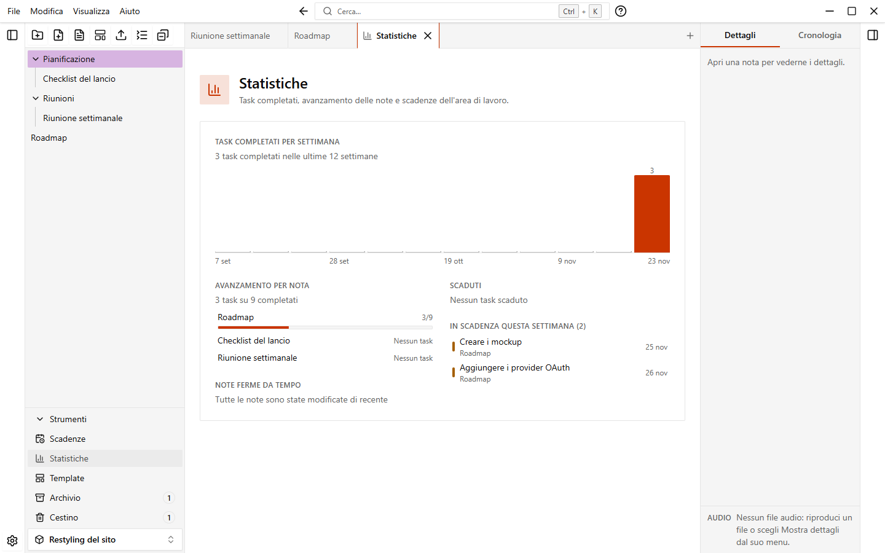

# Statistiche

La scheda Statistiche mostra come sta andando il lavoro del workspace. Aprila da **Statistiche** nella sezione **Strumenti** della barra laterale (vedi [La barra laterale](./folders-and-notes#la-barra-laterale)), dal menu **Visualizza** o dal menu comandi (`Ctrl+K`). Si apre come un tab, come **Novità**: se è già aperta passa in primo piano, e non viene riaperta al prossimo avvio.

## Cosa mostra

| Blocco | Cosa ti dice |
| --- | --- |
| **Task completati per settimana** | Una barra per ciascuna delle ultime 12 settimane, con il numero di task che hai completato. |
| **Avanzamento per nota** | Per ogni nota, quanti task sono fatti sul totale. |
| **Note ferme da tempo** | Note senza modifiche, nella nota o nei suoi task, da 30 giorni o più, e da quanto tempo. |
| **Scaduti** | I task aperti oltre la loro [scadenza](./due-dates). |
| **In scadenza questa settimana** | I task aperti che scadono nei prossimi giorni. |

Ogni elenco mostra le prime righe: clicca **Mostra tutti** per il resto. Clicca una nota per aprirla in un tab. Clicca un task per aprire la sua nota su quel task. Gli elementi nel cestino o nell'archivio non vengono contati.

## La data di completamento

Dalla versione 0.29.0 EasyTask registra il momento in cui un task viene completato, e lo cancella se riapri il task. I task già completati usano la data della loro ultima modifica, così il grafico non è vuoto: per loro la settimana è solo approssimata. I duplicati di una nota mantengono le date di completamento; un template no, e una nota creata da esso parte senza.
