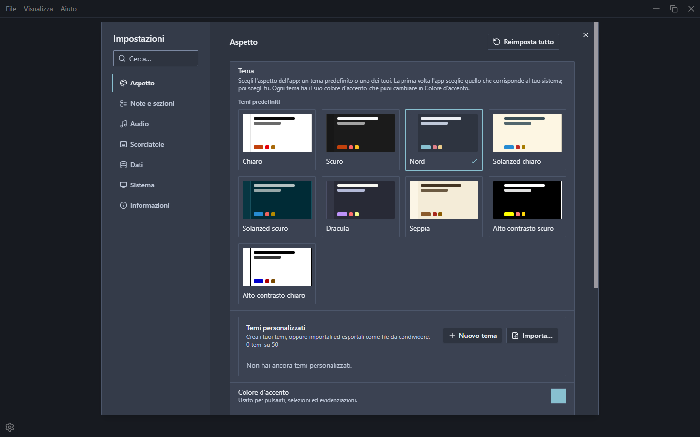
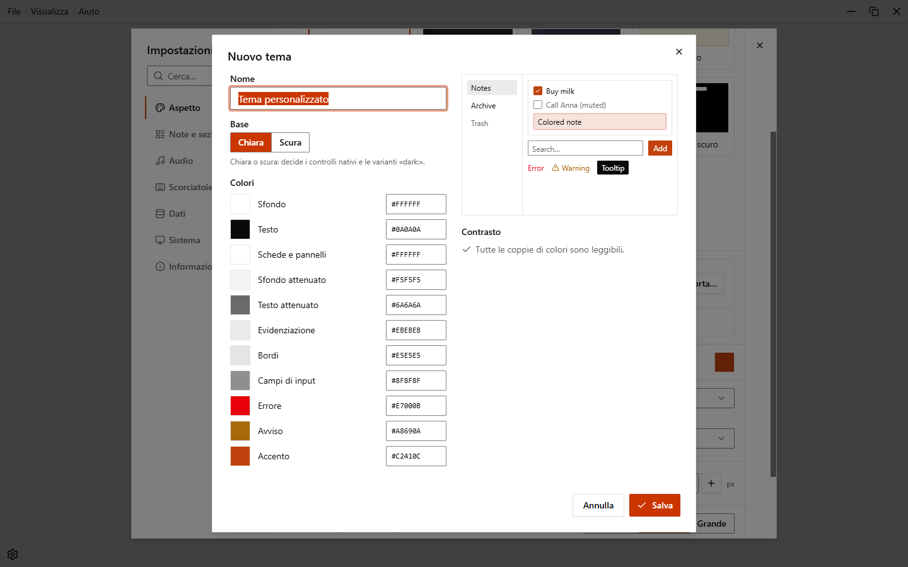

# Temi

Un tema decide i colori di tutta l'app: sfondo, testo, schede, bordi, evidenziazioni e colore d'accento. EasyTask ha nove temi predefiniti e ti lascia creare i tuoi.

## Scegliere un tema

Apri **Impostazioni > Aspetto**. La galleria **Tema** mostra un'anteprima di ogni tema: fai clic su uno per usarlo e usa le frecce per scorrere la galleria. Il tema in uso è segnato **In uso**. Puoi usare anche il menu **Visualizza > Tema**, che elenca i temi e ha **Gestisci temi…** per aprire le impostazioni.

La scelta **Sistema** non c'è più. Al primo avvio di EasyTask il tema iniziale è scelto dal sistema: Scuro se il sistema è scuro, Alto contrasto se il sistema chiede più contrasto, Chiaro negli altri casi. Poi resta quello che hai scelto.

## Temi predefiniti

| Tema | Base |
| --- | --- |
| Chiaro | Chiara |
| Scuro | Scura |
| Nord | Scura |
| Solarized chiaro | Chiara |
| Solarized scuro | Scura |
| Dracula | Scura |
| Seppia | Chiara |
| Alto contrasto chiaro | Chiara |
| Alto contrasto scuro | Scura |

I due temi **Alto contrasto** mantengono il rapporto di contrasto del testo a 7:1 o più. Sono pensati per chi vede poco.

Anche lo sfondo della finestra nativa segue il tema, quindi all'avvio non si vede il lampo bianco.

## Colore d'accento

Ogni tema ha il suo colore d'accento. Se scegli un colore in **Colore d'accento**, questo sovrascrive l'accento del tema; **Usa l'accento del tema** lo ripristina. L'avviso di contrasto funziona come prima, vedi [Colori](./colors#avviso-di-contrasto).

## Temi personalizzati

In **Impostazioni > Aspetto**, la sezione **Temi personalizzati** elenca i tuoi temi. Puoi averne fino a 50.

- **Nuovo tema** apre l'editor.
- Su ogni tema puoi **Modificare**, **Duplicare**, **Rinominare**, **Esportare** ed **Eliminare**. Se elimini il tema in uso, l'app torna al tema predefinito.

### L'editor

Dai un nome al tema, scegli la **Base** (chiara o scura: decide i controlli nativi) e imposta 11 colori:

| Colore | Usato per |
| --- | --- |
| Sfondo | Lo sfondo dell'app |
| Testo | Il testo principale |
| Schede e pannelli | Schede, finestre e pannelli |
| Sfondo attenuato | Le aree tranquille |
| Testo attenuato | Il testo secondario |
| Evidenziazione | Passaggi del mouse e selezioni |
| Bordi | Linee e bordi |
| Campi di input | Campi e controlli |
| Errore | Errori e azioni distruttive |
| Avviso | Avvisi |
| Accento | Pulsanti ed evidenziazioni |

Un'anteprima mostra il risultato mentre modifichi. Il riquadro **Contrasto** elenca le coppie di colori difficili da leggere. Gli avvisi sono solo informativi: puoi sempre salvare il tema.

::: tip
Parti da un tema predefinito: duplicalo e cambia solo i colori che vuoi.
:::

### Esportare e importare

**Esporta** salva un tema in un file `.easytask-theme.json` che puoi condividere. **Importa…** legge uno o più di questi file insieme; ogni file è controllato da solo, quindi uno non valido non ferma gli altri. Un file può pesare fino a 64 KiB e deve avere colori esadecimali validi; l'id scritto nel file viene ignorato, quindi un tema importato non sostituisce mai uno che hai già.

### Backup

I temi personalizzati sono salvati nel database, per tutti i workspace, quindi i [backup](./data-and-backups) li includono.

## Reimpostare

**Reimposta tutto** in Aspetto torna al tema scelto dal sistema. I tuoi temi personalizzati non vengono eliminati.
