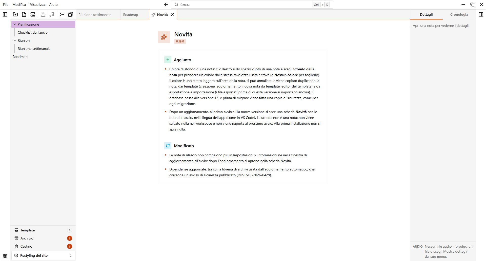
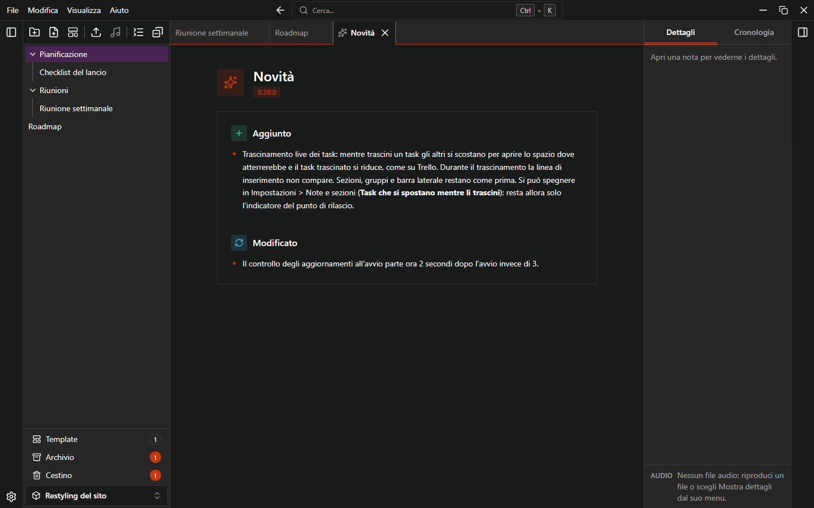

# Aggiornamenti

L'app installata può cercare nuove versioni, scaricarle e installarle. Gli aggiornamenti sono firmati e verificati prima dell'installazione.

## Controllo all'avvio

Pochi secondi dopo l'avvio, EasyTask cerca in silenzio una nuova versione. Se ce n'è una, si apre la finestra **Aggiornamento disponibile** con il numero della nuova versione. Offre tre scelte:

| Pulsante | Cosa fa |
| --- | --- |
| **Aggiorna ora** | Scarica e installa l'aggiornamento, poi riavvia l'app. |
| **Più tardi** | Chiude la finestra. Viene riproposta al prossimo avvio. |
| **Salta questa versione** | Non viene riproposta finché non esce una versione più recente. |

Non chiudere l'app durante il download e l'installazione: si riavvia da sola.

Per disattivare il controllo all'avvio vai in **Impostazioni > Informazioni** e disattiva **Controlla all'avvio**.

Se il controllo fallisce (per esempio sei offline), quello all'avvio non mostra nulla.

## Controllo manuale

1. Apri **Impostazioni > Informazioni**.
2. Clicca **Controlla aggiornamenti**.
3. Se c'è una versione disponibile, l'app ne mostra il numero. Clicca **Aggiorna ora** per scaricare, installare e riavviare.

Se sei aggiornato, l'app mostra "EasyTask è aggiornato."

## Novità dopo un aggiornamento

La prima volta che apri un workspace dopo un aggiornamento si apre una scheda **Novità** con le note della versione che stai usando, nella lingua dell'app.

{.light-only}
{.dark-only}

- Si apre una sola volta per ogni aggiornamento.
- Si chiude come una nota: **Chiudi la nota corrente** o `Ctrl+L`.
- Non è una nota: non ha un menu e non viene riaperta all'avvio.
- Una nuova installazione non la mostra.

## Note di rilascio

Per leggere le note di rilascio delle versioni precedenti scegli **Aiuto > Note di rilascio** nel menu. Si apre la pagina delle Release nel browser.

## Versione portable

La versione portable non si aggiorna da sola. Il controllo mostra un avviso e il pulsante **Apri la pagina delle Release**. Per aggiornare, scarica il nuovo zip e sostituisci `EasyTask.exe`: la cartella `data` resta. Vedi [Installazione](./install).
